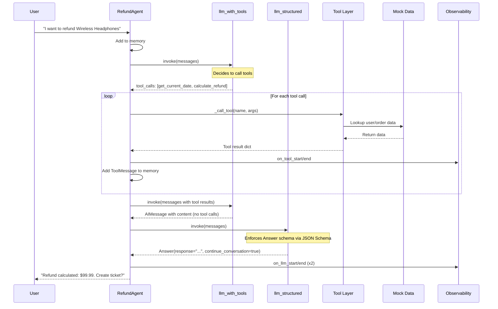

# Refund Agent

A customer-support refund agent built with Python, LangChain, Groq, and Pydantic. The agent processes refund requests by gathering information, verifying eligibility against order data and policies, and creating support tickets when needed.

## Features

- **Structured Output**: Uses Groq's JSON Schema mode to enforce `Answer` response format
- **Tool Calling**: Manual tool-calling loop with 4 tools (find_user, calculate_refund, get_current_date, create_ticket)
- **Observability**: Built-in callback handler tracking all LLM calls, tool calls, and errors
- **Conversation Memory**: Per-thread conversation memory with `continue_conversation` flag
- **Refund Policy**: 30-day refund window from purchase date

## Quick Start

### Prerequisites

- Python 3.14+
- [uv](https://github.com/astral-sh/uv) package manager
- Groq API key

### Installation

```bash
# Clone the repository
cd refund_agent

# Install dependencies
uv sync

# Copy environment example and add your API key
cp .env.example .env
# Edit .env and add your GROQ_API_KEY
```

### Running the Agent

```bash
# Run with default model
uv run main.py

# Run with custom model
GROQ_MODEL=openai/gpt-oss-120b
```

### Example Conversation

```
============================================================
Refund Agent Conversation (Thread: abc-123)
Model: openai/gpt-oss-120b
Type 'exit' or 'quit' to end the conversation
============================================================

Agent: Hello! I'd be happy to help you with a refund request. To get started, could you please provide your user ID (e.g., user_001)?

You: user_001

Agent: Great! I found your account. You have the following items in your order:
- Wireless Headphones (purchased 2024-03-15, $99.99)
- Phone Case (purchased 2024-03-15, $24.99)

Which item(s) would you like to refund?

You: Wireless Headphones

Agent: I'll check the eligibility for Wireless Headphones. Let me get the current date and calculate the refund.

[Tool calls: get_current_date, calculate_refund]

Agent: The Wireless Headphones were purchased on 2024-03-15, which is within the 30-day refund window. The refund amount would be $99.99. Would you like me to create a support ticket to process this refund?

You: Yes, please create the ticket.

Agent: [Tool call: create_ticket]

Agent: I've created a support ticket for your refund request.

Ticket ID: TKT-A1B2C3
Refund Amount: $99.99
Items: Wireless Headphones

Your refund has been escalated to our support team. They will process it within 3-5 business days. Is there anything else I can help you with?

You: No, thank you. Goodbye!

Agent: You're welcome! Thank you for contacting customer support. Have a great day!

============================================================
CONVERSATION SUMMARY
============================================================
Thread ID: abc-123
Total Events: 12
Tool Calls: 4
LLM Calls: 5
Tools Used: find_user, get_current_date, calculate_refund, create_ticket
Total Duration: 3421ms
Errors: 0
============================================================
```

## Project Structure

```
refund_agent/
├── agent/
│   ├── __init__.py
│   ├── models.py          # Pydantic models
│   ├── data.py            # Mock order data
│   ├── tools.py           # Tool implementations
│   ├── prompts.py         # System prompt
│   ├── agent.py           # Main agent logic
│   └── observability.py   # Observability callback handler
├── evals/
│   ├── __init__.py
│   ├── dataset.py         # Golden evaluation dataset (15 scenarios)
│   ├── eval_llm.py        # LLM evaluation adapter
│   ├── run_evals.py       # Main evaluation test runner
│   ├── task_completion.py # Task completion metric
│   ├── step_efficiency.py # Step efficiency metric
│   ├── plan_quality.py    # Plan quality metric
│   ├── plan_adherence.py  # Plan adherence metric
│   ├── answer_correctness.py # Answer correctness metric
│   └── tool_correctness.py   # Tool correctness metric
├── main.py                # Entry point
├── pyproject.toml         # Dependencies
├── uv.lock                # Locked dependencies
├── .env.example           # Environment template
├── CLAUDE.md              # Development guidance
└── README.md              # This file
```

## Architecture Overview

The refund agent follows a modular three-layer architecture:

```
┌─────────────────┐     ┌──────────────────────┐     ┌────────────────────┐
│   main.py       │────►│   RefundAgent        │────►│   Tool Layer       │
│   (entry point) │     │   (agent/agent.py)   │     │   (agent/tools.py) │
└─────────────────┘     └──────────────────────┘     └────────────────────┘
                              │          │          │
                              ▼          ▼          ▼
                       ┌──────────┐ ┌──────────┐ ┌──────────┐
                       │llm_with  │ │llm_struct│ │Observab- │
                       │_tools    │ │ured      │ │ility     │
                       │          │ │          │ │Handler   │
                       └──────────┘ └──────────┘ └──────────┘
                              │
                              ▼
                       ┌────────────────────────┐
                       │  find_user             │
                       │  calculate_refund      │
                       │  get_current_date      │
                       │  create_ticket         │
                       └────────────────────────┘
                              │
                              ▼
                       ┌────────────────────────┐
                       │   Data Layer           │
                       │   (agent/data.py)      │
                       │   MOCK_ORDERS_DICT     │
                       └────────────────────────┘
```

**Component Responsibilities:**

| Layer             | File                     | Responsibility                                                        |
| ----------------- | ------------------------ | --------------------------------------------------------------------- |
| **Entry**         | `main.py`                | CLI loop, user I/O                                                    |
| **Agent**         | `agent/agent.py`         | Conversation loop, tool orchestration, structured output              |
| **Tools**         | `agent/tools.py`         | Business logic: user lookup, refund calc, date check, ticket creation |
| **Data**          | `agent/data.py`          | Mock order database (`MOCK_ORDERS_DICT`)                              |
| **Observability** | `agent/observability.py` | Callback handler tracking all LLM/tool calls                          |

## Agent Loop - Detailed Flow

The `process_message` method executes a 4-step flow:

```python
def process_message(self, user_input: str) -> Answer:
    # 1. ADD TO MEMORY
    self.memory.append(HumanMessage(content=user_input))

    # 2. BUILD MESSAGES
    messages = [SystemMessage(content=SYSTEM_PROMPT)] + self.memory

    # 3. TOOL-CALLING LOOP (max 5 iterations)
    while iteration < max_iterations:
        response = self.llm_with_tools.invoke(messages)

        if response.tool_calls:
            # Execute each tool, add ToolMessage to memory
            for tool_call in response.tool_calls:
                result = self._call_tool(tool_call["name"], tool_call["args"])
                self.memory.append(ToolMessage(content=json.dumps(result),
                                                tool_call_id=tool_call["id"]))
            messages = [SystemMessage(content=SYSTEM_PROMPT)] + self.memory
            continue  # Next iteration with tool results

        # 4. FINAL: Structured output for Answer
        if response.content:
            answer = self.llm_structured.invoke(messages)
            return answer

    # Fallback on max iterations
    return Answer(response="Too many iterations", continue_conversation=True)
```

**Key Points:**

- Uses `llm_with_tools` for tool-calling iterations
- Switches to `llm_structured` (JSON Schema) for final `Answer` object
- Max 5 iterations prevents infinite loops
- Memory persists `HumanMessage`, `AIMessage`, `ToolMessage`

## Sequence Diagram - Refund Request Flow



## Two-LLM Design Pattern

Groq's Structured Output (`json_schema`) does NOT support tool calling, so we use two LLM instances:

```python
# In agent/agent.py _create_llm():

base_llm = ChatGroq(model=self.model_name, temperature=self.temperature,
                    api_key=api_key, callbacks=[self.observability])

# LLM 1: Tool-calling loop (NO structured output)
llm_with_tools = base_llm.bind_tools(TOOL_SCHEMAS)
# - Purpose: Tool-calling reasoning loop
# - Tools: ✅ Available (4 tools bound)
# - Output: AIMessage with tool_calls OR content
# - Schema: ❌ No structured output enforcement

# LLM 2: Final response formatting (NO tools)
llm_structured = base_llm.with_structured_output(Answer, method="json_schema")
# - Purpose: Final response formatting
# - Tools: ❌ Not available
# - Output: Answer Pydantic object (validated!)
# - Schema: ✅ Strict JSON Schema enforcement

# Both share the SAME ObservabilityCallbackHandler → all calls tracked!
```

**Flow:**

```
User Input
    │
    ▼
llm_with_tools ───► tool_calls? ───► YES ──► Execute tools ──► Add to memory ──► Loop
    │                    │
    │                    NO (has content)
    ▼
llm_structured ──► Answer(response="...", continue_conversation=True/False)
```

## Data Models

### Core Models (`agent/models.py`)

```python
class Item(BaseModel):
    name: str
    date_bought: date
    price: float

class Order(BaseModel):
    user_id: str
    items: List[Item] = Field(default_factory=list)

class Answer(BaseModel):
    """STRUCTURED OUTPUT - Enforced by Groq JSON Schema"""
    response: str
    continue_conversation: bool = True
```

### Observability Models

```python
@dataclass
class ObservabilityEvent:
    timestamp: datetime = field(default_factory=datetime.now)
    event_type: str = ""           # llm_start, llm_end, tool_start, etc.
    thread_id: str = ""
    details: Dict[str, Any] = field(default_factory=dict)
    duration_ms: Optional[float] = None

class ObservabilitySummary(BaseModel):
    thread_id: str
    total_events: int
    total_duration_ms: float
    tool_calls: int
    llm_calls: int
    tools_used: List[str]
    errors: List[Dict[str, Any]]
```

## Tools (`agent/tools.py`)

| Tool               | Input                                 | Output                              | Purpose             |
| ------------------ | ------------------------------------- | ----------------------------------- | ------------------- |
| `find_user`        | `user_id: str`                        | User dict or error                  | Lookup customer     |
| `calculate_refund` | `user_data: dict`, `items: list[str]` | Refund calc + items found/not found | Calculate refund    |
| `get_current_date` | (none)                                | `current_date: "YYYY-MM-DD"`        | Check 30-day window |
| `create_ticket`    | `user_id`, `reason`, `refund_amount`  | `ticket_id: "TKT-XXXXXX"`           | Escalate to support |

### Tool Schema Format (for LLM)

```python
TOOL_SCHEMAS = [
    {
        "name": "find_user",
        "description": "Search for a user in the system by user_id...",
        "parameters": {
            "type": "object",
            "properties": {
                "user_id": {"type": "string", "description": "..."}
            },
            "required": ["user_id"]
        }
    },
    # ... other tools
]
```

## Observability System (`agent/observability.py`)

### Callback Flow

```
┌─────────────────────────────────────────────────────────────────────────────┐
│                    OBSERVABILITY CALLBACK FLOW                              │
├─────────────────────────────────────────────────────────────────────────────┤
│                                                                             │
│  ChatGroq.invoke()                                                         │
│       │                                                                    │
│       ▼                                                                    │
│  ┌────────────────────────────────────────────────────────────────────┐   │
│  │ LangChain Core                                                     │   │
│  │   │                                                               │   │
│  │   ▼ on_llm_start(serialized, prompts)                             │   │
│  │   │   ├─ Creates event_id                                        │   │
│  │   │   ├─ Records start_time                                      │   │
│  │   │   ├─ Appends ObservabilityEvent(event_type="llm_start")      │   │
│  │   │   └─ Logs: "LLM START | model=... | prompt_chars=..."        │   │
│  │   │                                                               │   │
│  │   ▼ [LLM API CALL TO GROQ]                                        │   │
│  │   │                                                               │   │
│  │   ▼ on_llm_end(response)                                          │   │
│  │       ├─ Finds matching llm_start event by event_id              │   │
│  │       ├─ Calculates duration_ms                                  │   │
│  │       ├─ Extracts token_usage from response.llm_output           │   │
│  │       ├─ Appends ObservabilityEvent(event_type="llm_end",        │   │
│  │       │   duration_ms=..., details={tokens_used: ...})           │   │
│  │       └─ Logs: "LLM END | duration_ms=... | tokens=..."          │   │
│  │                                                                   │   │
│  └────────────────────────────────────────────────────────────────────┘   │
│                                    │                                        │
│                    Same pattern for tools:                                 │
│                                    │                                        │
│  ┌────────────────────────────────────────────────────────────────────┐   │
│  │ tool.invoke()                                                      │   │
│  │   │                                                                │   │
│  │   ▼ on_tool_start(serialized, input_str)                         │   │
│  │   │   ├─ Creates event_id                                        │   │
│  │   │   ├─ Records start_time                                      │   │
│  │   │   └─ Appends event(event_type="tool_start")                  │   │
│  │   │                                                                │   │
│  │   ▼ [TOOL EXECUTION]                                              │   │
│  │   │                                                                │   │
│  │   ▼ on_tool_end(output)                                           │   │
│  │       ├─ Calculates duration                                     │   │
│  │       └─ Appends event(event_type="tool_end", output=...)        │   │
│  └────────────────────────────────────────────────────────────────────┘   │
│                                                                             │
└─────────────────────────────────────────────────────────────────────────────┘
```

### Event Types Tracked

| Event Type     | Trigger          | Key Fields                                  |
| -------------- | ---------------- | ------------------------------------------- |
| `llm_start`    | Before LLM call  | `model`, `prompt_length`, `event_id`        |
| `llm_end`      | LLM success      | `duration_ms`, `tokens_used`, `generations` |
| `llm_error`    | LLM failure      | `error`, `error_type`                       |
| `tool_start`   | Before tool call | `tool`, `input`                             |
| `tool_end`     | Tool success     | `tool`, `output`, `duration_ms`             |
| `tool_error`   | Tool failure     | `error`, `error_type`                       |
| `agent_action` | Agent picks tool | `tool`, `tool_input`, `log`                 |
| `agent_finish` | Agent done       | `return_values`, `log`                      |

### Summary Aggregation

```python
def get_summary(self) -> Dict[str, Any]:
    total_duration = sum(e.duration_ms or 0 for e in self.events)
    tool_calls = [e for e in self.events if e.event_type == "tool_end"]
    llm_calls = [e for e in self.events if e.event_type == "llm_end"]

    return {
        "thread_id": self.thread_id,
        "total_events": len(self.events),
        "total_duration_ms": total_duration,
        "tool_calls": len(tool_calls),
        "llm_calls": len(llm_calls),
        "tools_used": list(set(e.details.get("tool") for e in tool_calls)),
        "errors": [e for e in self.events
                   if e.event_type in ("llm_error", "tool_error")],
    }
```

### Console Output Example

```
[Observability] Tools: 3 | LLM calls: 4 | Duration: 2450ms

CONVERSATION SUMMARY
============================================================
Thread ID: abc-123
Total Events: 14
Tool Calls: 3
LLM Calls: 4
Tools Used: find_user, get_current_date, calculate_refund
Total Duration: 2450ms
Errors: 0
============================================================
```

## Mock Data (`agent/data.py`)

```python
MOCK_ORDERS_DICT = {
    "user_001": {
        "user_id": "user_001",
        "items": [
            {"name": "Wireless Headphones", "date_bought": "2024-03-15", "price": 99.99},
            {"name": "Phone Case", "date_bought": "2024-03-15", "price": 24.99},
        ]
    },
    "user_002": {
        "user_id": "user_002",
        "items": [
            {"name": "Laptop Stand", "date_bought": "2024-02-20", "price": 49.99},
            {"name": "USB Cable", "date_bought": "2024-02-20", "price": 12.99},
        ]
    },
    # ... user_003, user_004
}
```

## Environment Variables

| Variable       | Required | Default               | Description  |
| -------------- | -------- | --------------------- | ------------ |
| `GROQ_API_KEY` | Yes      | -                     | Groq API key |
| `GROQ_MODEL`   | No       | `openai/gpt-oss-120b` | Model to use |

## Dependencies

See `pyproject.toml`. Key packages:

- `langchain-groq>=1.1.3` — Groq LLM integration
- `langchain-core>=0.2.0` — Core abstractions
- `langchain-tools>=0.1.34` — `@tool` decorator
- `langgraph>=0.1.0` — `InMemorySaver`
- `pydantic>=2.0` — Data validation
- `python-dotenv>=1.2.4` — Env loading

## Extending the Agent

### Adding a New Tool

1. **Add function** to `agent/tools.py` with `@tool` decorator
2. **Register** in `TOOLS` dict in `agent/agent.py`
3. **Add schema** to `TOOL_SCHEMAS` in `agent/agent.py`
4. **Update prompt** in `agent/prompts.py` if needed

### Adding Custom Observability

```python
# In any tool or agent method:
self.observability.events.append(ObservabilityEvent(
    event_type="custom_event",
    thread_id=self.thread_id,
    details={"key": "value"},
    duration_ms=123.4
))
```

## Evaluations (`evals/`)

The project includes a DeepEval-based evaluation suite to test the refund agent's behavior across various scenarios.

### Dataset (`evals/dataset.py`)

**15 test scenarios** covering the core refund workflow and edge cases:

| #   | Scenario                                       | User     | Items Requested                                 | Expected Outcome                           |
| --- | ---------------------------------------------- | -------- | ----------------------------------------------- | ------------------------------------------ |
| 1   | **Successful refund (all items)**              | user_001 | Wireless Headphones, Phone Case                 | Ticket created for $124.98                 |
| 2   | **Unbought item**                              | user_001 | Mechanical Keyboard                             | Refusal - item not in order                |
| 3a  | **Expired item only**                          | user_004 | Portable Charger                                | Refusal - outside 30-day window            |
| 3b  | **Mixed valid + expired**                      | user_004 | Bluetooth Speaker + Portable Charger            | Partial refund $79.99 for Speaker only     |
| 4   | **Invalid user**                               | user_999 | (any)                                           | Error - user not found                     |
| 5   | **Expired policy (single item)**               | user_003 | Smart Watch                                     | Refusal - outside 30-day window            |
| 6   | **Partial refund (1 of 3 items)**              | user_002 | USB-C Hub                                       | Refund $39.99, ticket created              |
| 7   | **No items specified**                         | user_001 | (none specified)                                | Agent asks for clarification               |
| 8   | **Multiple: some found, some not**             | user_001 | Wireless Headphones + Gaming Mouse + Phone Case | Partial refund $124.98, notes invalid item |
| 9   | **Policy query (informational)**               | (none)   | (none)                                          | Agent explains 30-day policy               |
| 10  | **Conversation end**                           | (any)    | (none)                                          | Polite goodbye, ends conversation          |
| 11  | **Natural language user ID**                   | user_002 | Laptop Stand                                    | Refund $49.99, ticket created              |
| 12  | **Confirm ticket creation**                    | user_001 | (confirmed)                                     | Ticket created with TKT-XXXXXX             |
| 13  | **All items expired**                          | user_003 | Smart Watch (all items)                         | Refusal - all outside window               |
| 14  | **Typo in item name**                          | user_001 | "Wireles Headphones"                            | Graceful handling, suggests correct name   |
| 15  | **User requests refund without prior context** | (any)    | (none)                                          | Agent asks for user ID and items           |

Each test case includes:

- `input`: User's natural language request
- `expected_output`: Expected agent response
- `context`: Background information for evaluation
- `expected_tools`: List of tools that should be called (for ToolCallingMetric)

### Running Evaluations

```bash
# Install dev dependencies (already done if using uv sync --dev)
uv sync --dev

# Run the dataset to verify structure
uv run python evals/dataset.py

# Run full DeepEval evaluation (requires GROQ_API_KEY)
GROQ_API_KEY=your_key uv run python evals/run_evals.py
```

### Metrics Used & File Structure

Each evaluation metric is implemented in a separate dedicated module inside the `evals/` folder. We use a target threshold of **0.7** for judging performance across all metrics, with empirical benchmark scores recorded to track improvements:

| Metric Name | File Path in `evals/` | Description / Purpose | Target Threshold | Observed Score / Status |
| --- | --- | --- | --- | --- |
| `task_completion` | `evals/task_completion.py` | Evaluates whether the agent successfully completes the refund/support task end-to-end according to user requirements | 0.7 | **53.3%** (~53.3) |
| `step_efficiency` | `evals/step_efficiency.py` | Evaluates tool call efficiency and minimal step count compared to optimal execution path | 0.7 | **0.35** (~35%) |
| `plan_quality` | `evals/plan_quality.py` | Evaluates the logical quality, feasibility, and correctness of execution plans | 0.7 | 0.7 (Target) |
| `plan_adherence` | `evals/plan_adherence.py` | Evaluates how closely the agent follows its planned step sequence during execution | 0.7 | 0.7 (Target) |
| `answer_correctness` | `evals/answer_correctness.py` | Evaluates factual accuracy and correctness of final agent response against expectations | 0.7 | 0.7 (Target) |
| `tool_correctness` | `evals/tool_correctness.py` | Evaluates tool selection, parameter correctness, and invocation ordering | 0.7 | 0.7 (Target) |

> **Threshold & Performance Summary:**
> - **Standard Target Threshold:** `0.7` across all evaluation metrics.
> - **Empirical Benchmark Performance:** 
>   - `task_completion`: Currently achieving around **53.3%** (`53.3`).
>   - `step_efficiency`: Currently achieving around **0.35** (`0.35`).
>   - Other metrics (`plan_quality`, `plan_adherence`, `answer_correctness`, `tool_correctness`) are judged against the target threshold of **0.7**.

### Evaluation Approach & Scope

The evaluation suite tests the **static logic and conversational behavior** of the refund agent against the current implementation. Here's what is and isn't covered:

#### ✅ In Scope (What We Evaluate)

| Category                  | Examples                                                                                                     |
| ------------------------- | ------------------------------------------------------------------------------------------------------------ |
| **User lookup**           | Valid/invalid user IDs, natural language user ID extraction                                                  |
| **Item validation**       | Items in order, items not purchased, typos in item names                                                     |
| **Policy enforcement**    | 30-day window check, expired items, mixed valid/expired                                                      |
| **Refund calculation**    | Full refund, partial refund (1 of N items), multiple items with some invalid                                 |
| **Tool calling sequence** | Correct tools called in right order: `find_user` → `get_current_date` → `calculate_refund` → `create_ticket` |
| **Conversation flow**     | Asking for clarification when items not specified, handling confirmations, graceful goodbye                  |
| **Response quality**      | Relevancy, faithfulness to context, professional tone                                                        |

#### ❌ Out of Scope (Not Currently Evaluated)

| Category                          | Reason                                                                     |
| --------------------------------- | -------------------------------------------------------------------------- |
| **Payment processing**            | Card expiration, refund to original payment method, different card refunds |
| **Ticket routing/escalation**     | Which team receives ticket, SLA tracking, ticket status updates            |
| **Inventory/restocking**          | Physical return logistics, restocking fees, item condition verification    |
| **Multi-turn conversation state** | Complex context across many turns (current max 5 iterations)               |
| **Concurrency/race conditions**   | Multiple simultaneous requests for same user/order                         |
| **Data persistence**              | Database writes, audit logs, order history modifications                   |
| **External integrations**         | Payment gateway APIs, email notifications, CRM sync                        |
| **Security/authorization**        | User authentication, session management, rate limiting                     |
| **Edge cases in date handling**   | Timezone issues, leap years, DST transitions                               |

#### 🔮 Future Evaluation Extensions

When the system evolves, consider adding:

- **Integration tests** with mock payment gateway for card refund scenarios
- **Conversation-level metrics** (coherence across 5+ turns)
- **Latency/performance benchmarks** (tool call duration, LLM response time)
- **Adversarial tests** (prompt injection, malicious inputs)
- **A/B testing framework** for prompt variations
- **Regression tests** for policy changes (e.g., 30→60 day window)

### Adding New Test Cases

1. Add a new `Golden` object in `evals/dataset.py`
2. Include `input`, `expected_output`, `context`, and `expected_tools`
3. Append to the `GOLDENS` list
4. Re-run evaluations

## License

MIT
